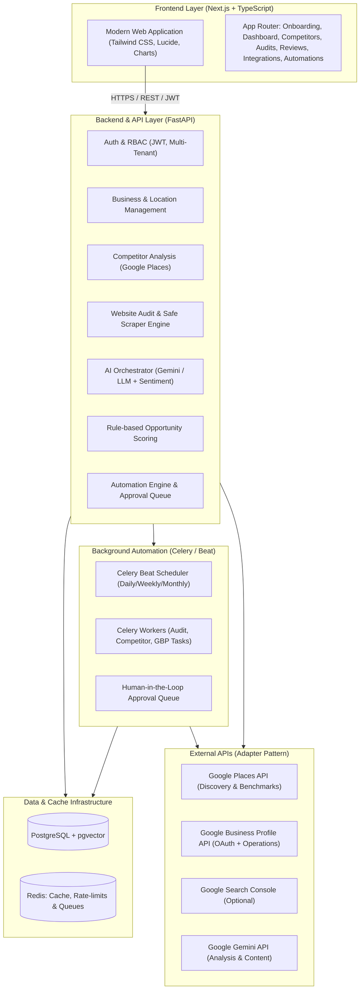

# Localyn — System Architecture Review & Implementation Blueprint

## 1. Executive Summary & Architectural Interpretation

**Localyn** is an AI-powered local business intelligence and automation platform. It is engineered to help SMBs (small and medium businesses) and digital marketing agencies audit local digital presence, monitor and benchmark competitors, optimize Google Business Profile (GBP) listings, perform technical SEO audits, analyze review sentiment, generate high-converting local content and AI-driven growth recommendations, and automate scheduled recurring tasks through an approval-gated workflow engine.

Based on the uploaded architectural blueprint, the platform consists of 6 integrated layers:

---

## 2. Key Architectural Decisions & Clarifications

1. **Monorepo Architecture**:
   - `backend/`: Python 3.13 + FastAPI + SQLAlchemy 2.0 (declarative models) + Alembic + Celery + Pydantic v2.
   - `frontend/`: Next.js 14+ (App Router) + TypeScript + Tailwind CSS + Lucide Icons + Recharts / lightweight SVG charts.
   - `docker-compose.yml`: Co-located PostgreSQL (with pgvector), Redis, FastAPI backend, Celery worker, and Next.js frontend.

2. **Multi-Tenant Isolation**:
   - Enforce organization-level tenant boundaries. Every `Business`, `Location`, `Audit`, `Competitor`, and `Job` is strictly scoped to an `organization_id`.
   - Access control middleware verifies tenant authorization on every request.

3. **External API Defense & Adapter Pattern**:
   - Provide concrete interface adapters (`BasePlacesClient`, `BaseGBPClient`, `BaseLLMClient`).
   - Deliver real operational implementations for Google Places, Gemini LLM, and Google Business Profile OAuth.
   - When credentials are not yet supplied by the user, the adapters operate in documented "Mock / Demo Mode" with realistic fixtures, clearly labelling data as simulated so the app remains 100% functional out-of-the-box.

4. **Security & SSRF Mitigation for Website Audit**:
   - Safe HTTP client enforcing IP allowlists and denying private IP ranges (`127.0.0.0/8`, `10.0.0.0/8`, `172.16.0.0/12`, `192.168.0.0/16`, `169.254.169.254`, `::1`).
   - Domain resolution checking before fetching.
   - Strict timeouts and HTML size limits to prevent DoS.

5. **AI Models & Scoring**:
   - Initial version implements a transparent, weighted rule-based **Business Opportunity Scoring Engine** (0–100 score with factor breakdowns: Website Health, Profile Completeness, Review Velocity/Sentiment, Competitor Saturation).
   - Sentiment analysis using rule-based sentiment heuristics + Gemini-augmented classification.
   - LLM Orchestrator strictly validates output with Pydantic JSON schemas before persisting.

6. **Automation & Safety Controls**:
   - Dual-tier automation: Low-risk actions (e.g., website re-audit, competitor snapshot refresh) run autonomously; High-risk actions (e.g., publishing GBP posts, responding to public reviews, updating business hours) transition to `awaiting_approval` in the human-in-the-loop Approval Queue.

---

## 3. Phased Implementation Roadmap

1. **Stage 1**: Architecture specification, data models, and API blueprints.
2. **Stage 2**: Project Scaffolding in `Localyn/` (FastAPI backend + Next.js frontend + Docker Compose).
3. **Stage 3**: Core Foundation: Database migrations, tenant isolation, authentication, business onboarding wizard, dashboard shell.
4. **Stage 4**: Intelligence Engines: Safe website SEO auditor, Google Places competitor discovery, rule-based Opportunity Scorer, Gemini AI recommendations.
5. **Stage 5**: Google Integrations Layer: Google OAuth flow, GBP locations adapter, sync manager, transparent status UI.
6. **Stage 6**: Automation & Approval Queue: Background task definitions, execution logs, human approval workflows, notification dispatcher.
7. **Stage 7**: Full UI Polish & Verification: 15 responsive pages, dark/light themes, data visualizations, end-to-end integration tests, health checks.
8. **Stage 8**: Deployment documentation: Docker Compose, `.env.example`, API keys guide, production readiness checklists.
